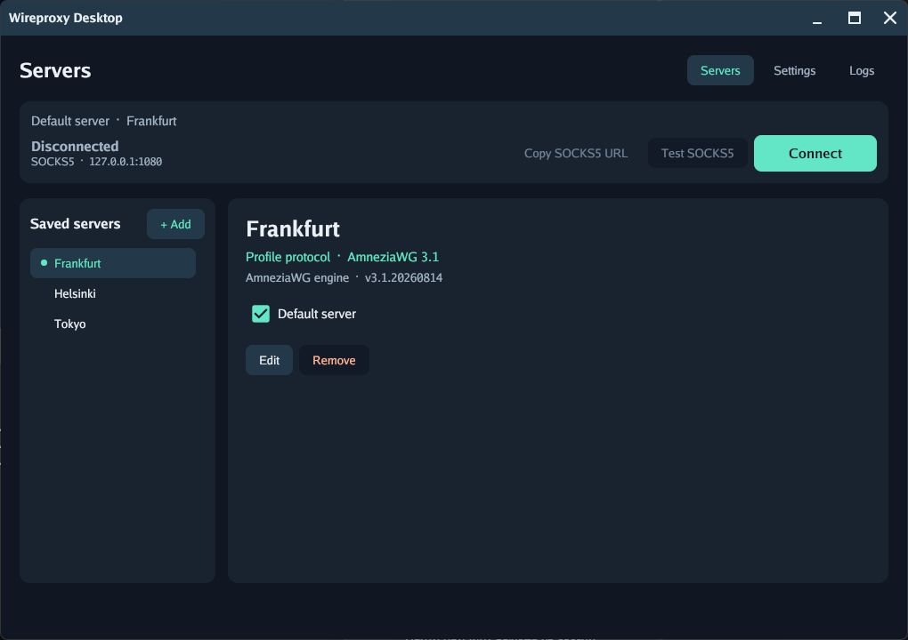

# Wireproxy Desktop

[Русский](README.md)

- A desktop app that runs a SOCKS5 proxy through your WireGuard or AmneziaWG server.

- **Local SOCKS5 with WireGuard v1 and AmneziaWG 3.1 support.** AmneziaWG 1.0, 1.5, 2.0, and 3.0 profiles are also supported. Configure the listen address and port, and enable username and password authentication if needed.
- **Configuration import and conversion.** Import `vpn://` links and `.conf` files, convert `vpn://` links to INI, and copy the result. Select a default server for quick access.
- **Background operation.** When a system tray is available, closing the window keeps the connection running. The tray icon shows the proxy status and lets you reopen the window.
- **Connection diagnostics.** Test profiles and the running SOCKS5 proxy over HTTPS. The SOCKS5 test tries a fallback site if the primary one fails. Tunnel events appear in the log.
- **Protected storage.** The OS credential store holds profiles, keys, and the SOCKS5 password. No analytics or automatic log uploads.
- **Windows, macOS, and Linux.** x64 and ARM64 builds with English and Russian interfaces that follow the system language by default.

## Download

[Latest release](https://github.com/WeslyG/wireproxy-desktop/releases/latest) · [All releases](https://github.com/WeslyG/wireproxy-desktop/releases) · [SHA256SUMS](https://github.com/WeslyG/wireproxy-desktop/releases/latest/download/SHA256SUMS)

| Platform | x64 | ARM64 |
| --- | --- | --- |
| Windows | [Download x64](https://github.com/WeslyG/wireproxy-desktop/releases/latest/download/wireproxy-desktop-windows-amd64.exe) | [Download ARM64](https://github.com/WeslyG/wireproxy-desktop/releases/latest/download/wireproxy-desktop-windows-arm64.exe) |
| macOS | [Download x64](https://github.com/WeslyG/wireproxy-desktop/releases/latest/download/wireproxy-desktop-macos-amd64.zip) | [Download ARM64](https://github.com/WeslyG/wireproxy-desktop/releases/latest/download/wireproxy-desktop-macos-arm64.zip) |
| Linux | [Download x64](https://github.com/WeslyG/wireproxy-desktop/releases/latest/download/wireproxy-desktop-linux-amd64) | [Download ARM64](https://github.com/WeslyG/wireproxy-desktop/releases/latest/download/wireproxy-desktop-linux-arm64) |

## System requirements

The prebuilt binary runs under a regular user account. It requires no installer, Go toolchain, or WireGuard driver.

| OS | Target environment | What you need to run it |
| --- | --- | --- |
| Windows | Windows 11, x64 or ARM64 | Open the downloaded `.exe`. No additional components are required. |
| macOS | macOS 15 Sequoia or later, Intel or Apple Silicon | Extract the ZIP and open Wireproxy Desktop.app in Finder. The built-in Keychain stores profiles. |
| Linux | Ubuntu 24.04 Desktop, x64 or ARM64 | An X11 or Wayland desktop session with EGL/OpenGL ES libraries and an available Secret Service. If your desktop lacks one, install GNOME Keyring or enable a compatible KWallet service. The tray requires a StatusNotifier host. |

The table lists the [build targets](.github/workflows/build.yml). Other Linux distributions need compatible system libraries. On Linux, you may need to make the downloaded file executable. For example, on Linux x64 run `chmod +x ./wireproxy-desktop-linux-amd64`, then `./wireproxy-desktop-linux-amd64`.

### First launch on macOS

1. Open ** → About This Mac**. Confirm that you have macOS 15 Sequoia or later. Download the **ARM64** ZIP for Apple Silicon or the **x64** ZIP for Intel.
2. Download the ZIP from [GitHub Releases](https://github.com/WeslyG/wireproxy-desktop/releases/latest) and compare its SHA-256 digest with the matching line in `SHA256SUMS`. Extract the ZIP, move **Wireproxy Desktop.app** to **Applications**, and double-click it.
3. The app has an ad hoc signature. It has no Developer ID signature or Apple notarization. If macOS says it cannot verify the app or its developer, dismiss the warning and open **System Settings → Privacy & Security**. Scroll to **Security** and click **Open Anyway** next to the message about Wireproxy Desktop. The button is available for about an hour after a launch attempt. If it is missing, try opening the app in Finder again.
4. Confirm that you want to open the app and enter your Mac login password if prompted. macOS remembers the exception for this app. [Apple’s instructions](https://support.apple.com/en-us/102445)
5. Read the app’s Keychain explanation and click **Continue**. Wireproxy Desktop uses its own entry to store profiles and proxy settings.

If macOS reports that the app is damaged or will damage your computer, stop and verify the source and the ZIP’s checksum. [macOS alerts](https://support.apple.com/en-us/102445)

## Connect

1. In **Servers**, add a profile from a `vpn://` link or a `.conf` file. Switch to **INI** to decode a link into a configuration you can copy.
2. Click **Connect**. Mark a **Default server** to connect to it from other tabs.
3. Set your browser or other app to `socks5://127.0.0.1:1080`, or copy the actual URL from Wireproxy Desktop.

Supports **WireGuard v1** and **AmneziaWG 1.0, 1.5, 2.0, 3.0, and 3.1** profiles. The server card shows the profile version and the bundled engine version separately. For INI files, the app infers the profile version from its parameters.

Settings let you choose the UI language, configure the SOCKS5 address and port, check port availability, and enable username and password authentication. SOCKS5 can listen on a local address or on all IPv4 or IPv6 interfaces.

## Secret storage

| OS | Where profiles, keys, and the SOCKS5 password are stored |
| --- | --- |
| Windows | DPAPI-encrypted data in the current user's registry |
| macOS | System Keychain |
| Linux | Secret Service, such as GNOME Keyring or KWallet |

On first launch, the app migrates the old configuration to protected storage and removes the old JSON after verifying the saved copy. `--portable` uses a separate entry in the OS store for the executable directory.

## Updates

Release builds check GitHub Releases at startup. Open **Settings → Updates** to check manually, read release notes, or visit the release page. **Install and restart** downloads the binary for your platform, verifies its SHA-256 digest, and restarts the app. The executable directory must be writable.

## Diagnostics

**Check connection** runs an HTTPS test through the draft profile. **Test SOCKS5** checks the running proxy after the handshake. The activity log shows tunnel state, WireGuard events, and test results. You can enable verbose logging, copy the log, or follow new entries.

## Privacy

**No analytics, telemetry, tracking, or automatic log uploads.** Logs stay in memory. Update checks contact GitHub, and diagnostics you start send an HTTPS request to `example.com` through the tunnel being tested and fall back to `www.gstatic.com`.

## Stack and build

Go, [Gio](https://gioui.org/) for the interface, and [wireproxy-awg](https://github.com/WeslyG/wireproxy-awg) with AmneziaWG-Go for the tunnel. GitHub Actions builds six platform and architecture combinations. Go 1.26.11 or later is required.

For development, install Docker and the **Dev Containers** extension in VS Code, open the repository, and choose **Dev Containers: Reopen in Container**. The container includes Go and Gio's Linux build dependencies. Run `go test -tags novulkan ./...` and `go build -tags novulkan -o ./wireproxy-desktop .` from its terminal. To check the GUI and secret storage integration, run a build in a graphical session on the target OS.

| Platform | Command |
| --- | --- |
| Windows | `go build -trimpath -ldflags="-s -w -H=windowsgui" -o wireproxy-desktop.exe .` |
| macOS | `sh scripts/build-macos-app.sh "Wireproxy Desktop.app"` |
| Linux | `CGO_ENABLED=1 go build -tags novulkan -trimpath -o wireproxy-desktop .` |

Building on macOS requires Xcode Command Line Tools. Building on Linux requires a C compiler, `pkg-config`, and the [Gio development packages](https://gioui.org/doc/install/linux). Where a system tray is available, closing the window keeps the app and proxy running in the background. Disconnect in the app or quit from the tray to stop the proxy. Listener changes take effect on the next connection.
