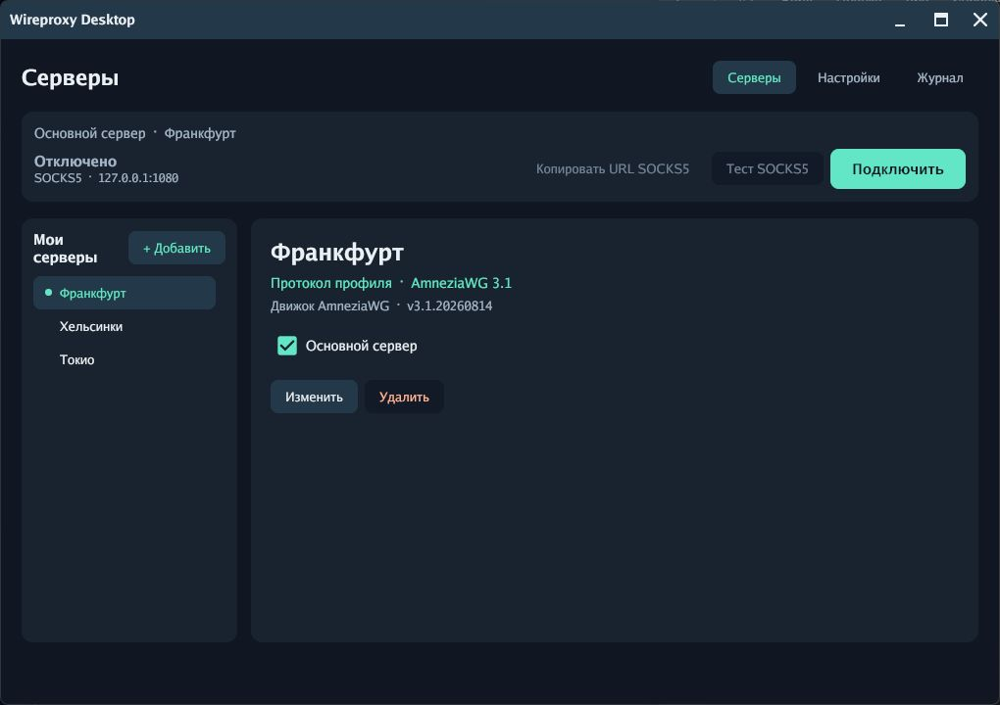

# Wireproxy Desktop

[English](README.en.md)

- Настольное приложение, которое поднимает SOCKS5-прокси через ваш сервер WireGuard или AmneziaWG.

- **Локальный SOCKS5 с поддержкой WireGuard v1 и AmneziaWG 3.1.** Также поддерживаются профили AmneziaWG 1.0, 1.5, 2.0 и 3.0. Адрес и порт прокси настраиваются, при необходимости можно включить вход по логину и паролю.
- **Импорт и конвертация конфигураций.** Импортируйте ссылки `vpn://` и файлы `.conf`, конвертируйте ссылки `vpn://` в INI и копируйте результат. Выберите основной сервер для быстрого подключения.
- **Работа в фоне.** При наличии системного трея закрытие окна сохраняет соединение. Значок показывает состояние прокси и позволяет снова открыть окно.
- **Диагностика соединения.** Проверяйте профили и рабочий SOCKS5 через HTTPS. При сбое основного сайта тест SOCKS5 пробует резервный. События туннеля видны в журнале.
- **Защищённое хранение.** Профили, ключи и пароль SOCKS5 хранятся в системном хранилище. Аналитики и автоматической отправки журналов нет.
- **Windows, macOS и Linux.** Сборки для x64 и ARM64, русский и английский интерфейс с автоматическим выбором по языку системы.

## Скачать

[Последний релиз](https://github.com/WeslyG/wireproxy-desktop/releases/latest) · [Все релизы](https://github.com/WeslyG/wireproxy-desktop/releases) · [SHA256SUMS](https://github.com/WeslyG/wireproxy-desktop/releases/latest/download/SHA256SUMS)

| Система | x64 | ARM64 |
| --- | --- | --- |
| Windows | [Скачать x64](https://github.com/WeslyG/wireproxy-desktop/releases/latest/download/wireproxy-desktop-windows-amd64.exe) | [Скачать ARM64](https://github.com/WeslyG/wireproxy-desktop/releases/latest/download/wireproxy-desktop-windows-arm64.exe) |
| macOS | [Скачать x64](https://github.com/WeslyG/wireproxy-desktop/releases/latest/download/wireproxy-desktop-macos-amd64.zip) | [Скачать ARM64](https://github.com/WeslyG/wireproxy-desktop/releases/latest/download/wireproxy-desktop-macos-arm64.zip) |
| Linux | [Скачать x64](https://github.com/WeslyG/wireproxy-desktop/releases/latest/download/wireproxy-desktop-linux-amd64) | [Скачать ARM64](https://github.com/WeslyG/wireproxy-desktop/releases/latest/download/wireproxy-desktop-linux-arm64) |

## Системные требования

Готовая сборка запускается от обычного пользователя. Установщик, Go и драйвер WireGuard для запуска не нужны.

| ОС | Целевая среда | Что нужно для запуска |
| --- | --- | --- |
| Windows | Windows 11, x64 или ARM64 | Запустите скачанный `.exe`. Дополнительных компонентов нет. |
| macOS | macOS 15 Sequoia или новее, Intel или Apple Silicon | Распакуйте ZIP и откройте Wireproxy Desktop.app в Finder. Для хранения профилей используется встроенная связка ключей. |
| Linux | Ubuntu 24.04 Desktop, x64 или ARM64 | Нужна графическая сессия X11 или Wayland с системными библиотеками EGL/OpenGL ES и доступное хранилище Secret Service. Если в вашей среде его нет, установите GNOME Keyring или включите совместимый сервис KWallet. Для трея нужен StatusNotifier-хост. |

Таблица указывает [целевые среды сборки](.github/workflows/build.yml). На других дистрибутивах Linux нужны совместимые системные библиотеки. На Linux скачанному файлу может потребоваться право на выполнение. Например, для Linux x64 выполните `chmod +x ./wireproxy-desktop-linux-amd64`, затем `./wireproxy-desktop-linux-amd64`.

### Первый запуск на macOS

1. Откройте ** → Об этом Mac**. Убедитесь, что установлена macOS 15 Sequoia или новее. Для Mac с чипом Apple скачайте ZIP для **ARM64**, для Mac с процессором Intel — ZIP для **x64**.
2. Скачайте ZIP из [GitHub Releases](https://github.com/WeslyG/wireproxy-desktop/releases/latest) и сверьте его SHA-256 со строкой для этого файла в `SHA256SUMS`. Распакуйте архив, перенесите **Wireproxy Desktop.app** в папку **Программы** и откройте его двойным щелчком.
3. У приложения есть подпись ad hoc. Подпись Developer ID и нотариализация Apple отсутствуют. Если macOS сообщит, что не может проверить разработчика или приложение, закройте предупреждение и откройте **Системные настройки → Конфиденциальность и безопасность**. Прокрутите до раздела **Безопасность** и нажмите **Всё равно открыть** рядом с сообщением о Wireproxy Desktop. Кнопка доступна примерно час после попытки запуска. Если её нет, ещё раз попробуйте открыть приложение в Finder.
4. Подтвердите открытие и, если macOS попросит, введите пароль учётной записи Mac. macOS запомнит исключение для этого приложения. [Инструкция Apple](https://support.apple.com/ru-ru/102445)
5. В приложении прочитайте пояснение о Связке ключей и нажмите **Продолжить**. Wireproxy Desktop использует свою запись для профилей и настроек прокси.

Если macOS сообщает, что приложение повреждено или может навредить компьютеру, остановитесь и проверьте источник и контрольную сумму архива. [Предупреждения macOS](https://support.apple.com/ru-ru/102445)

## Подключение

1. В разделе **Серверы** добавьте профиль из ссылки `vpn://` или файла `.conf`. Вкладка **INI** преобразует ссылку в конфигурацию, которую можно скопировать.
2. Нажмите **Подключить**. Отметьте **Основной сервер**, чтобы быстро подключаться к нему с других вкладок.
3. Укажите `socks5://127.0.0.1:1080` в браузере или другом приложении либо скопируйте фактический URL из Wireproxy Desktop.

Приложение работает с **WireGuard v1** и профилями **AmneziaWG 1.0, 1.5, 2.0, 3.0 и 3.1**. В карточке сервера отдельно показаны версия профиля и версия встроенного движка. Для INI версия профиля определяется по параметрам.

В настройках можно выбрать язык, адрес и порт SOCKS5, проверить доступность порта и включить авторизацию по логину и паролю. Для прослушивания доступны локальные интерфейсы и все интерфейсы IPv4 или IPv6.

## Хранение секретов

| ОС | Где хранятся профили, ключи и пароль SOCKS5 |
| --- | --- |
| Windows | Шифротекст DPAPI в реестре текущего пользователя |
| macOS | Системная связка ключей (Keychain) |
| Linux | Secret Service, например GNOME Keyring или KWallet |

При первом запуске старая конфигурация переносится в защищённое хранилище. Приложение удаляет старый JSON после проверки сохранённых данных. `--portable` создаёт отдельную запись хранилища ОС для каталога запуска.

## Обновления

Релизная сборка проверяет GitHub Releases при запуске. Автопроверку можно отключить в **Настройки → Обновления**. Новая версия появляется в нижней строке окна. Кнопка **Что нового** открывает список изменений в приложении. В Windows и Linux **Установить и перезапустить** скачивает бинарник, проверяет SHA-256 и перезапускает приложение. Для этого каталог программы должен быть доступен на запись. На macOS кнопка открывает релиз с ZIP-архивом для ручной замены приложения.

## Диагностика

**Проверить подключение** тестирует черновик профиля через HTTPS. **Тест SOCKS5** проверяет рабочий прокси после рукопожатия. В журнале видны состояние туннеля, события WireGuard и результаты проверок. Доступны подробный режим, копирование и автоматическая прокрутка.

## Конфиденциальность

**Без аналитики, телеметрии, трекеров и автоматической отправки журналов.** Журнал хранится в памяти. Проверка обновлений обращается к GitHub, а диагностика по кнопке делает HTTPS-запрос к `example.com` через проверяемый туннель и при сбое пробует `www.gstatic.com`.

## Стек и сборка

Go, [Gio](https://gioui.org/) для интерфейса, [wireproxy-awg](https://github.com/WeslyG/wireproxy-awg) и AmneziaWG-Go для туннеля. GitHub Actions собирает шесть платформенных вариантов. Требуется Go 1.26.11 или новее.

Для разработки установите Docker и расширение **Dev Containers** в VS Code, откройте репозиторий и выберите **Dev Containers: Reopen in Container**. Контейнер включает Go и зависимости Gio для Linux. В его терминале выполните `go test -tags novulkan ./...` и `go build -tags novulkan -o ./wireproxy-desktop .`. Для проверки окна и интеграции с хранилищем секретов запускайте сборку в графической сессии целевой ОС.

| Платформа | Команда |
| --- | --- |
| Windows | `go build -trimpath -ldflags="-s -w -H=windowsgui" -o wireproxy-desktop.exe .` |
| macOS | `sh scripts/build-macos-app.sh "Wireproxy Desktop.app"` |
| Linux | `CGO_ENABLED=1 go build -tags novulkan -trimpath -o wireproxy-desktop .` |

Для сборки на macOS нужны Xcode Command Line Tools. Для сборки на Linux нужны компилятор C, `pkg-config` и [пакеты разработки для Gio](https://gioui.org/doc/install/linux). При наличии трея закрытие окна оставляет приложение и прокси в фоне. Чтобы остановить прокси, отключитесь в приложении или выберите выход в трее. Настройки прослушивания применяются при следующем подключении.
